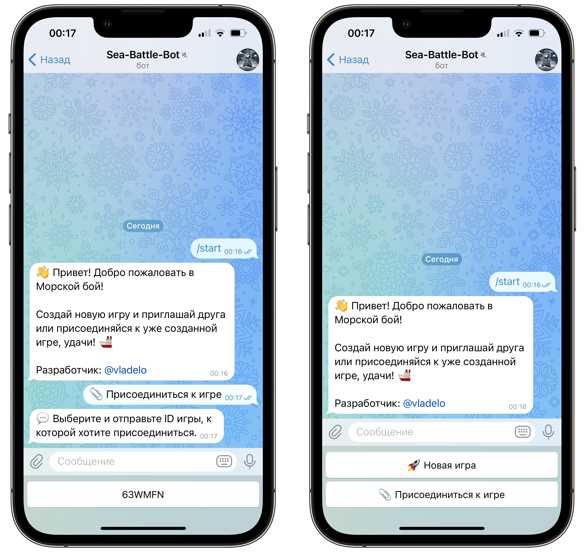
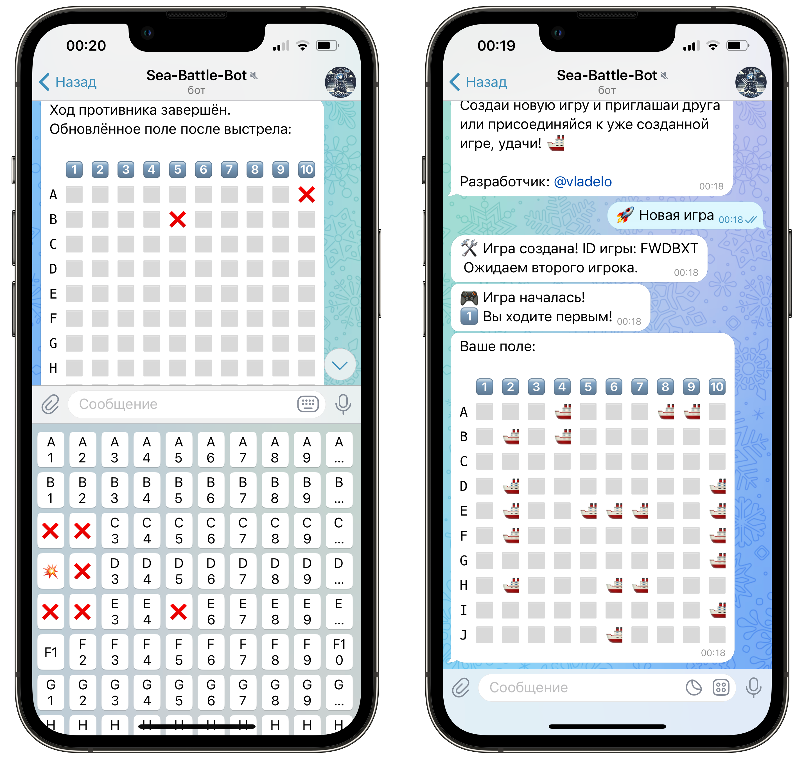

# **Sea-Battle-Bot** 🌊

**Sea-Battle-Bot** — это увлекательный Telegram-бот для игры в классический **морской бой** между двумя игроками! 💥
Погрузитесь в атмосферу морского сражения и испытайте свои тактические навыки на поле боя! ⚔️

🚀 **[Перейти к боту в Telegram](https://t.me/vladelo_sea_battle_bot)**

---

## 🎮 **Основные возможности**

- 🆕 **Создание новой игры** и подключение к существующей.
- 👥 **Дуэли между двумя игроками** в реальном времени.
- 🔥 **Полноценная механика боя** с интуитивным вводом координат.
- 🎯 **Интерактивные кнопки** для выстрелов по полю.
- 📡 **Уведомления о ходе игры** и результатах выстрелов.
- 🗺️ **Отображение** своего и вражеского поля.
- 📝 **Подробные сообщения** о ходе и результатах игры.
- 🏳️ **Возможность сдаться** в любой момент.
- 📋 **Личная статистика** – матчи, победы, поражения, рейтинг.
- 📊 **Рейтинг игроков** на основе системы Elo.

---





---

### 🎯 Технологии

Бот реализован с использованием следующих технологий и библиотек:

- **[Aiogram](https://docs.aiogram.dev/)** — асинхронный фреймворк для создания Telegram-ботов на Python. Позволяет
  легко работать с Telegram API и поддерживает работу с инлайн-кнопками, командами и обработчиками сообщений.
- **[SQLAlchemy](https://www.sqlalchemy.org/)** — ORM-библиотека для работы с базой данных. Используется для хранения
  информации об игроках, матчах и статистике.
- **[Alembic](https://alembic.sqlalchemy.org/)** — инструмент миграций базы данных, позволяющий управлять схемой БД и
  изменениями структуры таблиц.
- **[Asyncio](https://docs.python.org/3/library/asyncio.html)** — встроенная библиотека Python для асинхронного
  программирования. Используется для выполнения асинхронных задач и обеспечения высокой производительности бота.
- **[Python-dotenv](https://pypi.org/project/python-dotenv/)** — библиотека для загрузки переменных окружения из файла
  `.env`. Упрощает хранение токена бота и других настроек.
- **[Random](https://docs.python.org/3/library/random.html)** — стандартная библиотека Python для генерации случайных
  чисел. Используется для случайного выбора первого игрока и генерации игрового поля.
- **[OS](https://docs.python.org/3/library/os.html)** — стандартная библиотека Python для работы с операционной
  системой. Используется для получения переменных окружения и управления файловой системой.

---

## 📂 **Структура проекта**

```

/Sea-Battle-Bot
│── app/
│   ├── bot.py               # Основной запуск и регистрация хендлеров
│   ├── config.py            # Загрузка настроек (токен для бота)
│   ├── database.py          # Создание подключения к БД
│   ├── handlers.py          # Обработчики команд и сообщений бота
│   ├── dependencies.py      # Зависимости (например, get_db)
│   ├── logger.py            # Логгер
│   ├── utils.py             # Вспомогательные функции (например, генерация ID игры)
│   ├── storage.py           # Логика работы с играми в памяти (create_game и т.д.)
│   ├── game_logic.py        # Логика игры: создание и изменение поля, установка кораблей и т.д.
│   ├── db_utils/            # Функции для работы с базой данных, разбиты по зонам ответственности
│   │   ├── __init__.py
│   │   ├── match.py         # Работа с матчами (создание, обновление результатов)
│   │   ├── player.py        # Работа с игроками (создание, получение, обновление)
│   │   ├── stats.py         # Работа со статистикой (создание, получение, обновление статистики)
│   ├── models/              # Модели SQLAlchemy
│   │   ├── __init__.py
│   │   ├── base.py          # Общая база моделей
│   │   ├── player.py        # Модель игрока Player
│   │   ├── player_stats.py  # Модель статистики игрока PlayerStats
│   │   ├── match.py         # Модель матча Match
│   └── keyboards.py         # Клавиатуры для бота
│── .env                  # Файл с токеном бота (НЕ добавляется в Git)
│── requirements.txt      # Зависимости (aiogram, dotenv и др.)
│── README.md             # Инструкция по установке и запуску

```

---

## 🛠️ **Технические детали**

- 🐍 Язык программирования: **Python**
- 🤖 Фреймворк: **Aiogram**
- 🗃️ Хранение данных: **SQLite** с использованием **SQLAlchemy** и миграций через **Alembic**
- 🔄 Асинхронность: реализована через **asyncio** для высокой производительности
- 💡 Логика игры: поля представлены в виде двумерного списка с символами:
    - ⬜ — пустая клетка
    - 🚢 — часть корабля
    - ❌ — промах
    - 💥 — попадание
- 📊 Рейтинг: рассчитывается по системе **Elo** после каждой завершённой игры

---

## 📝 **Установка и запуск**

### 🔧 Вариант 1: Локальный запуск

1. 🗃️ Клонируйте репозиторий:
   ```bash
   git clone https://github.com/QuestGuideRF/sea-battle-bot.git
   ```
2. 📂 Перейдите в папку проекта:
   ```bash
   cd sea-battle-bot
   ```
3. 📦 Установите зависимости:
   ```bash
   pip install -r requirements.txt
   ```
4. ⚙️ Создайте `.env` на основе `.env.template` и укажите ваш токен:
   ```bash
   cp .env.template .env
   ```
5. 🛠️ Примените миграции базы данных:
    ```bash
   alembic upgrade head
   ```
6. 🚀 Запустите бота:
   ```bash
   python app/bot.py
   ```

### 🐳 Вариант 2: Запуск через Docker

1. Клонируйте репозиторий:
   ```bash
   git clone https://github.com/QuestGuideRF/sea-battle-bot.git
   ```
2. Перейдите в папку проекта:
   ```bash
   cd sea-battle-bot
   ```
3. Создайте `.env` на основе `.env.template` и укажите ваш токен:
   ```bash
   cp .env.template .env
   ```
4. Постройте и запустите контейнер:
   ```bash
   docker run -it --env-file .env sea-battle-bot
   ```

---

## 💡 **Пример использования**

1. Создайте новую игру:
   ```
   🚀 Новая игра
   ```
2. Подключитесь к игре, выбрав ID в появившемся списке, после команды:
   ```
   📎 Присоединиться к игре
   ```
3. Дождитесь начала боя и ходите первым, если повезёт! 🍀
4. Используйте клавиатуру для выстрелов и следите за результатами:
    - 💥 — попадание!
    - ❌ — промах.
    - 🚢 — корабль на вашем поле.
    - ⬜ — пустая клетка.
5. Наслаждайтесь эпичными морскими баталиями! 🌊

---

## 🛠 **Дополнительно**

- Чтобы скрыть `BOT_TOKEN`, **не загружай `.env` в Git** (он уже в `.gitignore`).

- Бот поддерживает ReplyKeyboardMarkup и KeyboardButton для функционирования кнопок управления.

- База данных SQLite **создаётся автоматически** при первом запуске миграций с помощью Alembic, поэтому никаких
  дополнительных действий по созданию базы не требуется.

- Все изменения структуры базы данных **управляются миграциями**, которые необходимо применять перед запуском бота.

Подпись относится к текущей версии проекта.

---

Автор: legenda  
Telegram: [@LEGENDA_SD](https://t.me/LEGENDA_SD)
